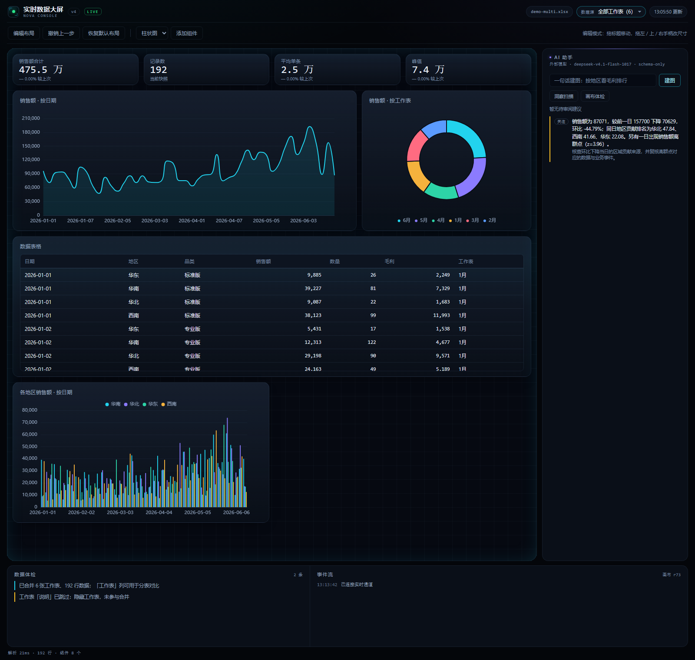
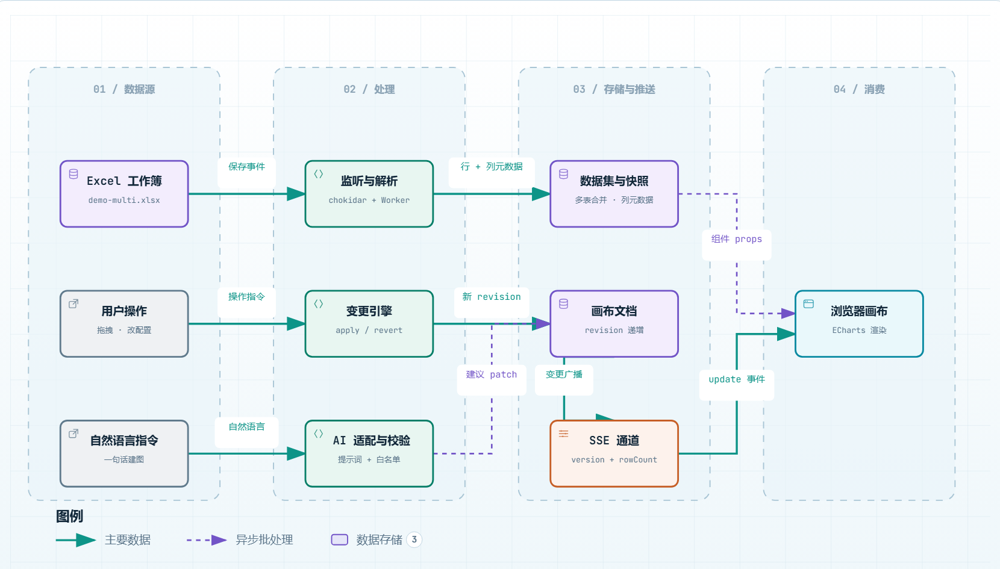

<div align="center">

# 实时 Excel 数据大屏

**把 Excel 当数据源用：文件一保存，浏览器里的大屏就刷新。**

本地 Node 服务 · 零前端构建 · 无数据库 · 默认不联网

`Node.js ≥ 20.12` · `50 项自动化测试` · `v1.4.0`

[快速开始](#快速开始) · [功能](#功能) · [换成自己的表](#换成自己的表) · [配置](#配置) · [API](#api-速览) · [架构](#架构) · [设计文档](docs/architecture.md)



</div>

## 这个项目做什么

做报表的人大多经历过同一套流程：Excel 里改数据 → 重新做图 → 发给别人 → 数据又变了。上 BI 工具则要连库、建模型、配权限，为一张天天变动的表付出太多。

这个项目把 Excel 文件本身当成数据源：**保存文件，页面在几百毫秒内自动更新**。服务跑在本机，只监听一个文件，不需要数据库、不需要前端构建，默认也不向任何外部服务发送数据。

技术上它是一条完整的实时数据管道：文件监听 → 隔离进程解析 → 不可变快照 → SSE 通知 → 按版本拉取投影 → 低代码画布渲染。附带一层可选的 AI 适配（一句话建图、洞察扫描、画布体检），默认离线规则模式，不联网也能用。

## 功能

### 实时与解析

- **文件监听**：chokidar 监听目标文件所在目录，350ms 稳定窗口 + 220ms 防抖，避免写入中途读到半个文件
- **单飞摄入**：同一时刻只跑一次解析；新事件用代次（generation）标记，过期结果直接丢弃
- **隔离解析**：`worker_threads` 里跑 SheetJS，内存上限 512MB、超时 30s，主进程不受脏文件拖累
- **格式与结构**：支持 `.xlsx` / `.xls` / `.csv`；自动探测表头行、推断数字与日期、跳过「合计」行
- **多表合并**：默认合并所有可见工作表并追加「工作表」虚拟列，也可切到单表视图；页面顶部下拉随时切换
- **脏数据体检**：空列、重复表头、类型混杂、超限截断都以 warnings 展示，不静默吞掉

### 画布与交互

- **低代码画布**：12 栅格布局，6 类组件（KPI / 折线 / 柱状 / 饼图 / 表格 / 文本）
- **直接编辑**：拖标题移动、拖左 / 上 / 右手柄改尺寸，栅格重叠会被拒绝
- **可撤销**：每个 Patch 都带逆操作，撤销一步回到上一状态
- **持久化**：画布存 `data/document.json`，原子写入，损坏文件自动降级备份
- **恢复默认**：换了一张结构不同的表，一键按新 schema 重排

### AI 适配层（可选）

- **两种提供方**：`rule` 离线规则（默认，不联网、零成本）/ `openai` 任意兼容端点（DeepSeek、通义、智谱等）
- **三个能力**：一句话建图（自然语言 → 组件配置）、洞察扫描（异常与趋势）、画布体检（定位失效组件并给出修复 Patch）
- **可控边界**：模型域名白名单、并发上限 2、每日任务预算 200、单次超时 20s；默认只发 schema 与少量样例行，`AI_SAMPLES=0` 可完全关闭数据外发
- **可审阅**：AI 生成的改动先落成 Patch 草稿，接受才生效；没有密钥时自动降级为规则模式

### 工程与安全

- **默认只监听 `127.0.0.1`**；对外提供服务必须同时配置访问口令与 Host 白名单，否则拒绝启动
- **写接口防跨站**：校验 `Sec-Fetch-Site` 与 `Origin`；口令经 `POST /api/session` 换成 HttpOnly + SameSite=Strict 的 Cookie
- **CSP、X-Frame-Options、nosniff、路径穿越防护**，请求体与 SSE 缓冲都有硬上限
- **可观测**：`/api/health`、`/api/ready`、`/api/diagnostics`，结构化日志与本地指标
- **测试**：9 个测试文件、50 项用例，覆盖解析、调度、安全、API、SSE、分页、Document、Patch、投影与 AI 协议

## 快速开始

要求 **Node.js ≥ 20.12**（用到 `process.loadEnvFile`，推荐 22 LTS）。

```bash
npm install
cp .env.example .env        # Windows: copy .env.example .env
npm run sample              # 生成示例工作簿 data/sales.xlsx（默认监听它）
npm run dev
```

打开 <http://127.0.0.1:3000>。`dev` 模式会额外注册「模拟一次变更」按钮，方便观察实时刷新。

想看多表合并的效果，把 `.env` 里的 `TARGET_FILE` 指向 `data/demo-multi.xlsx`（先 `npm run sample:multi` 生成），重启服务即可。

示例数据有三个来源，按需生成：

| 命令 | 产出 | 用途 |
|---|---|---|
| `npm run sample` | `data/sales.xlsx` | 单表 6 列销售流水，最小可用 |
| `npm run sample:multi` | `data/demo-multi.xlsx` | 6 张同构月表 + 1 张隐藏说明页，演示合并视图与分表对比 |
| `npm run sample:office` | `data/samples/*.xlsx` | 7 份结构各异的办公表（订单、花名册、库存、报销、工时、工单、月报） |

`npm run verify:samples` 会把 7 份表逐份解析、生成默认布局并投影，几秒内确认每张表都能出可用组件。

## 换成自己的表

三种方式，从轻到重：

1. **覆盖同名文件**（最省事）：把新内容另存为当前被监听的文件名，服务自动刷新，无需重启。
2. **改配置**：`.env` 里把 `TARGET_FILE` 指向新文件（或改 `DATA_DIR`），重启服务。
3. **结构不同**：换表后在页面点「恢复默认布局」，让组件按新列重新生成，否则旧图会提示「列不存在」。

CSV 也可以直接指向，分隔符自动识别；非 UTF-8 编码建议先另存为 UTF-8，避免中文列名读成乱码。单文件默认上限 25MB / 10 万行 / 100 列。

## 常用命令

| 命令 | 作用 |
|---|---|
| `npm start` | 生产方式启动（不注册模拟接口） |
| `npm run dev` | 开发启动，启用 `/api/simulate` |
| `npm test` | 跑全部 50 项测试（约 12s） |
| `npm run benchmark` | 造 1 万行工作簿，测解析、worker 往返与内存；`BENCH_ROWS=50000` 可调规模 |
| `npm run verify:samples` | 批量冒烟检查示例表能否出图 |
| `npm run shot -- --url <地址> --out <文件>` | 无头 Edge 截图（本地辅助脚本，需已安装 Edge） |

## 配置

全部配置走环境变量或项目根目录的 `.env`；**系统环境变量优先，`.env` 不会覆盖已存在的同名变量**。完整清单与逐项注释见 [`.env.example`](.env.example)。

| 变量 | 默认 | 说明 |
|---|---|---|
| `TARGET_FILE` | `data/sales.xlsx` | 要监听的 Excel / CSV 文件 |
| `DATA_DIR` | `data/` | 数据目录，`TARGET_FILE` 留空时用它拼默认路径 |
| `SOURCE_MODE` | `merged` | `merged` 合并所有可见表；`sheet` 只看一张 |
| `DOCUMENT_FILE` | `data/document.json` | 画布配置持久化位置 |
| `PORT` / `HOST` | `3000` / `127.0.0.1` | 监听地址 |
| `ACCESS_TOKEN` | 空 | 访问口令，绑定非回环地址时必填 |
| `ALLOWED_HOSTS` | 回环三项 | Host 白名单，绑定非回环地址时必填 |
| `AI_PROVIDER` | `rule` | `rule` 离线规则 / `openai` 兼容端点 |
| `AI_API_KEY` | 空 | 仅服务端持有；留空时即使选 `openai` 也降级为 rule |
| `AI_BASE_URL` / `AI_MODEL` | `https://api.deepseek.com` / `deepseek-chat` | 兼容端点与模型名 |
| `AI_ALLOWED_HOSTS` | 四家常用域名 | 允许调用的模型域名，逗号分隔 |
| `AI_SAMPLES` | `1` | 是否在提示词里带少量样例行，`0` = 不发任何数据值 |
| `MAX_FILE_BYTES` | `25MB` | 单文件上限 |
| `MAX_ROWS` / `MAX_COLUMNS` / `MAX_CELLS` | `100000` / `100` / `2000000` | 解析上限，超限直接报错而不是拖垮进程 |
| `MAX_SHEETS` / `MAX_WORKBOOK_ROWS` | `50` / `200000` | 合并视图的张数与总行数上限 |

接入在线模型的最小配置（密钥只留在服务端）：

```dotenv
AI_PROVIDER=openai
AI_API_KEY=sk-********************
AI_BASE_URL=https://api.deepseek.com
AI_MODEL=deepseek-chat
AI_ALLOWED_HOSTS=api.deepseek.com
```

### 局域网大屏

```bash
HOST=0.0.0.0 PORT=3000 \
ACCESS_TOKEN=换成强口令 \
ALLOWED_HOSTS=192.168.1.10:3000 \
npm start
```

浏览器访问 `http://192.168.1.10:3000/?token=换成强口令`，口令换成 Cookie 后 URL 会自动清理。**不要在缺口令的情况下绑定 `0.0.0.0`**，配置校验会直接拒绝启动。

## API 速览

完整契约见 [docs/architecture.md · 第 7 章](docs/architecture.md#7-api-契约)。

| 方法 | 路径 | 说明 |
|---|---|---|
| GET | `/api/state` | 快照元数据（不含行数据与绝对路径） |
| GET | `/api/projection` | 元数据 + KPI + 各组件 props，前端一次拉全 |
| GET | `/api/rows?offset&limit` | 原始行分页，`limit ≤ 500` |
| GET | `/api/sheets` | 工作表列表与当前数据源 |
| POST | `/api/dataset/source` | 切换合并 / 单表视图 |
| GET | `/api/document` | 当前画布定义 |
| POST | `/api/document/patches` | 提交 Patch（`add` / `remove` / `move` / `resize` / `remap` / `retitle` / `restyle`） |
| POST | `/api/document/patches/dry-run` | 只校验不落盘，预览结果 |
| POST | `/api/document/patches/:id/revert` | 撤销某个 Patch |
| POST | `/api/ai/chart` | 一句话建图 |
| POST | `/api/ai/insights/scan` | 洞察扫描 |
| POST | `/api/ai/maintenance/scan` | 画布体检 |
| GET | `/api/health`、`/api/ready` | 健康与就绪探针 |
| GET | `/api/events` | SSE 实时通知 |

几个常用调用：

```bash
# 看当前版本与行数
curl -s http://127.0.0.1:3000/api/state | jq '{version, revision, rowCount, status}'

# 先试算再提交：改一个 KPI 的标题
curl -s -X POST http://127.0.0.1:3000/api/document/patches/dry-run \
  -H 'Content-Type: application/json' \
  -d '{"op":"retitle","idTarget":"kpi-sum","title":"销售额合计（万元）"}'

# 离线规则模式也能建图
curl -s -X POST http://127.0.0.1:3000/api/ai/chart \
  -H 'Content-Type: application/json' \
  -d '{"instruction":"按地区看毛利排行"}'
```

SSE 事件：

| 事件 | 触发时机 | 客户端动作 |
|---|---|---|
| `ready` | 连接建立 | 标记连接并同步一次 |
| `status` | 解析开始 / 失败 / 完成 | 更新状态点 |
| `update` | 新快照就绪 | 记日志并拉 `/api/projection` |
| `failure` | 解析失败 | 保留旧图，展示错误 |
| `document` | 画布被修改 | 重新拉画布并重绘 |
| `ai-insight` / `ai-suggestion` / `ai-task` | AI 任务进展 | 更新侧栏卡片 |

推送只带版本号与元数据，慢客户端只保留最新一条通知；缓冲超过 64KB 直接断开重连，避免内存被拖爆。

## 架构

```text
Excel 保存
  └─ chokidar（350ms 稳定窗口）
       └─ IngestService.schedule（220ms 防抖 + 代次 + 单飞）
            └─ worker_threads 解析（SheetJS，512MB / 30s 上限）
                 └─ 不可变快照 SnapshotRepository（version++）
                      ├─ SSE 广播 update
                      └─ 浏览器拉 /api/projection
                           └─ 组件投影 → ECharts 重绘
```



数据和结构走两条独立路径：**Excel 变化产生新快照**（推数据），**画布编辑产生 Patch**（推结构）。两者都用版本号驱动前端更新，互不阻塞。

```text
live-sheet-dashboard/
├─ server/                 27 个模块，纯 ESM，无框架
│  ├─ index.mjs            进程入口：信号处理与安全关闭
│  ├─ app.mjs              组合根：装配仓库、worker、SSE、HTTP、AI
│  ├─ http.mjs             路由与请求处理
│  ├─ ingest.mjs           摄入调度：防抖、代次、单飞
│  ├─ watcher.mjs          chokidar 监听
│  ├─ workbook-worker.mjs  worker 线程：解析与体检
│  ├─ worker-client.mjs    主线程侧封装：超时、重启、内存上限
│  ├─ parser.mjs           表头探测、类型推断、多表合并
│  ├─ dataset.mjs          不可变快照与数据源视图
│  ├─ document.mjs         画布模型、栅格与校验
│  ├─ patch.mjs            7 种操作的 apply / inverse
│  ├─ component-projection.mjs  组件 props 投影与聚合
│  ├─ document-store.mjs   原子持久化与损坏恢复
│  └─ ai/                  适配层：协议、提供方、编排、分析
├─ web/                    原生 HTML/CSS/JS，无构建步骤
├─ tests/                  9 个文件 50 项用例（node:test）
├─ scripts/                示例数据、基准、冒烟检查、截图
├─ docs/                   架构文档、设计图、截图
└─ data/                   被监听的表格与画布配置
```

几个关键取舍：

- **投影而不是推全量**：SSE 只推版本号与元数据，浏览器再按需拉投影，慢客户端永远不会被大 payload 拖住。
- **worker 隔离**：解析面对的是不可信输入，放进独立线程并设内存与时间上限，主进程只负责调度。
- **Patch 而非整份覆盖**：每次改动都是可逆操作，撤销、审阅、AI 建议复用同一套协议。
- **零构建前端**：三个文件加一个 `/vendor` 静态映射，省掉工具链，也方便把整个目录拷到任意机器上跑。

## 测试与实测

```bash
npm test              # 50 项，约 12s
npm run benchmark     # 1 万行 × 6 列
```

本机（Windows / Node 22）参考值：

| 场景 | 结果 |
|---|---|
| `demo-multi.xlsx`（6 张月表合并后 192 行，含读盘与合并） | 39ms |
| `sales.xlsx`（单表 120 行） | 10ms |
| 1 万行 × 6 列：解析 | 409ms |
| 1 万行 × 6 列：worker 往返（含线程通信） | 529ms |
| 常驻内存（1 万行快照） | RSS 约 158MB |
| 自动化测试 | 50 项全通过 |

## 设计边界

明确不做的事，避免误用：

- **只读 Excel**，不写回、不修改被监听的文件
- **单进程单实例**，没有多用户、权限与租户隔离，画布只有一份
- AI **不流式输出**；`rule` 模式只做模板化建图，复杂语义建议接在线模型
- 不做公网部署方案（没有 TLS、限流与审计），LAN 内使用也请务必配口令
- 不支持 Excel 公式求值、透视表、图表对象等工作簿特性，只读取单元格值

## 文档

| 文件 | 内容 |
|---|---|
| [docs/architecture.md](docs/architecture.md) | 完整设计方案：质量目标、模块与依赖规则、领域模型、状态机、API 契约、安全、可观测性、测试矩阵、交付边界 |
| [design-specs/nova-console-ui.md](design-specs/nova-console-ui.md) | 界面设计规范：栅格、配色、组件状态 |
| [docs/figures/](docs/figures) | 架构图、功能模块图、数据模型图、数据流图（`.html` 为可交互版本） |
| [docs/screenshots/](docs/screenshots) | 各示例表、编辑态与 AI 侧栏截图 |

## 许可证

暂未声明开源许可证。如需公开发布，建议先补一份 `LICENSE`（MIT 或 Apache-2.0 皆可）。

<div align="center"><sub>本地优先 · 保存即刷新 · 数据不出机器</sub></div>
